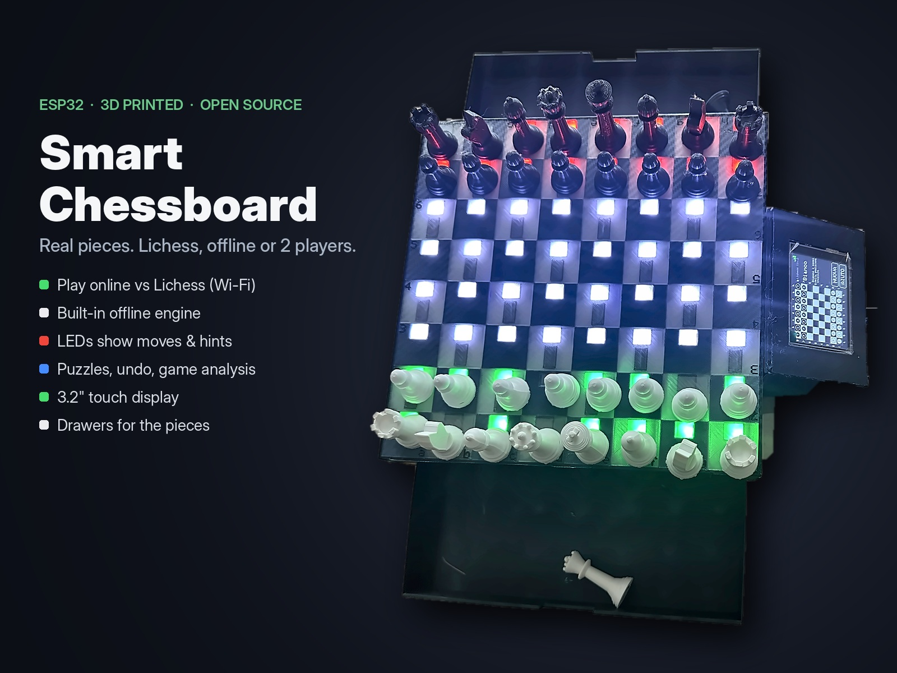
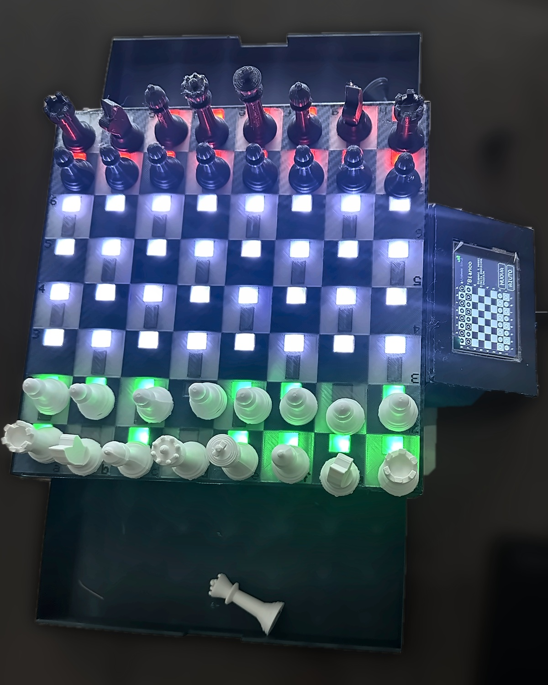
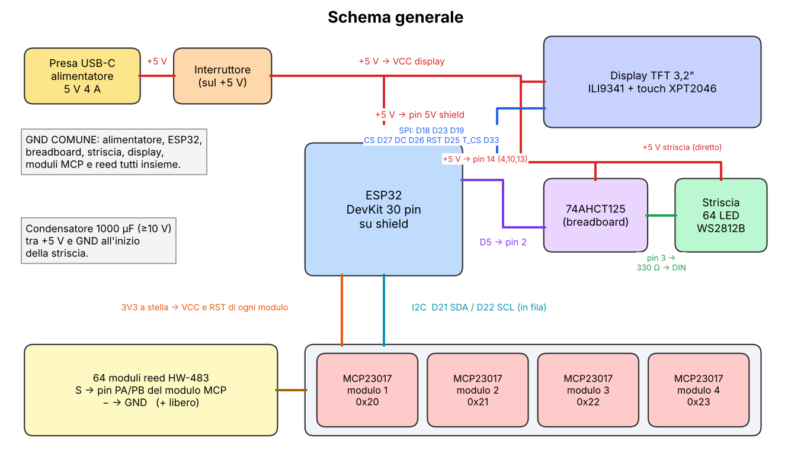

# Smart Chessboard ESP32 · Scacchiera intelligente ESP32

A 3D-printed smart chessboard driven by an ESP32. Play with real pieces against **Lichess**, against the **built-in offline engine**, against a **friend**, or solve **130 built-in puzzles**. Every square detects pieces with a reed sensor and lights up with an RGB LED, and a 3.2" touch display shows the game.

🇮🇹 *Italiano più sotto.*

---

## Features

- **Lichess online** over Wi-Fi: play against Stockfish levels 1–8 (requires a free Lichess token)
- **Offline engine**: levels 1–4, opening book, varied play
- **2 players** on the same board
- **Puzzles**: 130 built-in mate-in-1/2/3 puzzles (random order, all verified), plus puzzles downloaded from Lichess
- **Hints, undo and game analysis**
- **LEDs** show the last move, hints, check and the result (green: White wins, red: Black wins, white: draw)
- **Full chess rules**: castling, en passant, under-promotion, checkmate, stalemate, threefold repetition, 50-move rule, insufficient material. The move generator is verified with the standard *perft* tests.
- **Wi-Fi setup** from the touch screen (network scan and on-screen keyboard) or from your phone (setup page)
- **No glue**: everything is held by 4 screws, with two drawers for the pieces

## Two versions

| Folder | Board size | Printer bed | LED strip | Status |
|---|---|---|---|---|
| `stl/268` | 268 × 268 mm, 33 mm squares | ≥ 270 × 270 mm (e.g. Bambu H2S / H2D / H2C) | WS2812B **30 LED/m**, 3 m | ✅ built and tested |
| `stl/254_non_testata` | 254 × 254 mm, 31 mm squares | 256 × 256 mm (Bambu X1 / P1 / P2S / A1) | WS2812B **144 LED/m**, 2 m | ⚠️ **untested**: derived from the tested design and checked on the computer only |

## Arduino setup

1. **Board package:** install **esp32 by Espressif** in Boards Manager and select the board **ESP32 Dev Module**.
2. **Libraries** (Library Manager):
   - Adafruit ILI9341
   - Adafruit GFX
   - XPT2046_Touchscreen (Paul Stoffregen)
   - Adafruit MCP23017 Arduino Library
   - Adafruit NeoPixel
   - ArduinoJson (v7)
3. **Open the sketch:** open `arduino/scacchiera_completa/scacchiera_completa.ino` (268 version) or `arduino/scacchiera_254/scacchiera_254.ino` (254 version).
4. **Settings:** lines marked `<<< MODIFICA` are the settings you may change. Wi-Fi and the Lichess token can stay empty, because you can enter them later from the touch screen.
5. **Upload**, then set the Serial Monitor to 115200 baud.

**Test sketches** (run them first): `test_display_tft`, `calibra_touch`, `test_led_scacchiera` (or `test_led_254`), `test_wifi_display`.

The full guide with wiring, the reed map and troubleshooting (in Italian) is in [`docs/Guida_scacchiera_intelligente.pdf`](docs/Guida_scacchiera_intelligente.pdf).

## Bill of materials

| # | Part | Must-have specs | Qty | Example link |
|---|---|---|---|---|
| 1 | ESP32 + expansion board | ESP32-WROOM-32, 30 pin, USB-C | 1 | [Temu](https://www.temu.com/goods.html?goods_id=607691414019561) |
| 2 | 3.2" display | ILI9341 240×320 SPI **with XPT2046 touch** | 1 | [AliExpress](https://www.aliexpress.com/item/1005009660218585.html) |
| 3 | I2C I/O modules | MCP23017 (addresses 0x20–0x23, set with A0–A2) | 4 | [AliExpress](https://www.aliexpress.com/item/1005010439375368.html) |
| 4 | Reed sensor modules | KY-021 / HW-483 | 64 | [AliExpress](https://www.aliexpress.com/item/1005008746870273.html) |
| 5 | LED strip | WS2812B 5 V, IP30, black PCB: 30 LED/m 3 m (268) – 144 LED/m 2 m (254) | 1 | [AliExpress](https://www.aliexpress.com/item/1005007989207832.html) |
| 6 | Level shifter | SN74**AHCT**125N DIP-14 (not HC) | 1 | [AliExpress](https://www.aliexpress.com/item/1005007655828920.html) |
| 7 | IC sockets | DIP-14 | 1 | [AliExpress](https://www.aliexpress.com/item/1005006774601425.html) |
| 8 | Power supply | 5 V 4 A, USB-C | 1 | [AliExpress](https://www.aliexpress.com/item/1005010254336772.html) |
| 9 | Neodymium magnets | N52, 8×3 mm (one per piece) | 32 | [AliExpress](https://www.aliexpress.com/item/1005012787119852.html) |
| 10 | Dupont wires | 10 cm, M-F / F-F | ~140 | [Temu](https://www.temu.com/goods.html?goods_id=607116358158781) |
| 11 | Silicone wire | 22 AWG (LED power) | a few m | [Temu](https://www.temu.com/goods.html?goods_id=601099513962206) |
| 12 | Lever connectors | 2/3/5-way | a few | [Temu](https://www.temu.com/goods.html?goods_id=607318959863531) |
| 13 | Resistor + capacitor | 330 Ω + 1000 µF ≥ 6.3 V | 1+1 | – |
| 14 | Power switch | ≥ 3 A | 1 | – |
| 15 | Screws | M3×12 self-tapping | 4 | – |

## Printing

- PLA, 0.2 mm layers, 15–20 % infill, no supports.
- The play surface is multicolor: print `1a`/`1b`/`1c` together as one object, face down.

---

## 🇮🇹 Italiano

Scacchiera intelligente stampata in 3D con un ESP32. Si gioca con pezzi veri contro **Lichess**, contro il **motore offline**, **in 2** o risolvendo **130 problemi** (matto in 1, 2 e 3). Ogni casella riconosce i pezzi con un sensore reed e si illumina con un LED RGB. Un display touch da 3,2" mostra la partita.

- **Versione 268 mm** (`stl/268`): costruita e testata. Serve un piatto di almeno 270 × 270 mm.
- **Versione 254 mm** (`stl/254_non_testata`): per piatti da 256 mm, **non testata dall'autore**. Usa la striscia da 144 LED/m e lo sketch `scacchiera_254`.

**Installazione:**
1. Scheda **ESP32 Dev Module**.
2. Librerie elencate sopra.
3. Apri lo sketch dalla sua cartella e modifica solo le righe `<<< MODIFICA`. Wi-Fi e token Lichess si possono inserire anche dal display.

Guida completa: [`docs/Guida_scacchiera_intelligente.pdf`](docs/Guida_scacchiera_intelligente.pdf)

**Non condividere mai il tuo token Lichess** e non caricarlo su GitHub.

## License

[CC BY-NC-SA 4.0](https://creativecommons.org/licenses/by-nc-sa/4.0/): you may build, share and modify it with attribution, but not sell it. Puoi rifarla e modificarla citando l'autore, ma non venderla.
